<picture>
  <source media="(prefers-color-scheme: dark)" srcset="assets/hero-dark.svg">
  
</picture>

<p align="center">
  <a href="https://linkedin.com/in/sahil-ijaz-a75b15281/"></a>&nbsp;
  <a href="mailto:hssahil2913@gmail.com"></a>&nbsp;
  <a href="https://x.com/sahilijaz99"></a>&nbsp;
  <a href="https://www.codewars.com/users/SahilIjaz"></a>&nbsp;
  <a href="https://leetcode.com/u/SahilIjaz01/"></a>
</p>

<p align="center">
  &nbsp;
  &nbsp;
  &nbsp;
  
</p>

---

## About me

I am a software engineer who cares about what happens after the code is written: how it is built, tested, packaged, deployed and kept healthy. I spent two years going deep on backend engineering, shipping REST APIs, authentication, databases and real-time systems in Node.js and Python. Since late 2025 my focus has shifted to the delivery side: CI pipelines, Docker images, Kubernetes manifests, cloud deployments and the observability that makes a service trustworthy in production.

```yaml
name: Sahil Ijaz
role: Software Engineer (DevOps focused)
location: Lahore, Pakistan
open_to: [remote roles, contract work, open source]

journey:
  - 2023:                 self-taught · C++, JavaScript, first Node.js services
  - Jan 2024 → Sep 2025:  Backend Developer · APIs, auth, databases, real-time
  - Oct 2025 → present:   Software Engineer (DevOps focused) · CI/CD, containers, cloud

focus:
  delivery:   [GitHub Actions, Docker, Kubernetes, Nginx, Dependabot]
  cloud:      [AWS (EC2, S3, Lambda, CloudFront), Azure, Render, Vercel, Firebase]
  backend:    [Node.js, Express, NestJS, FastAPI, Socket.io]
  data:       [PostgreSQL, MongoDB, Redis, RabbitMQ, Prisma, Airflow]
  frontend:   [Next.js, React, TypeScript, Tailwind CSS]

contact: hssahil2913@gmail.com
```

## How I ship

<picture>
  <source media="(prefers-color-scheme: dark)" srcset="assets/pipeline-dark.svg">
  
</picture>

- **Verify every change.** Path-filtered CI per service: lint, type-check, tests on a version matrix, and a Docker build that must succeed before merge. Dependabot keeps dependencies and workflow actions current.
- **Package once, run anywhere.** Multi-stage Dockerfiles with pinned dependencies and no build toolchain in the final image. The same image runs in Compose locally, on Render, and in Kubernetes.
- **Deploy with guard rails.** Readiness and liveness probes, persistent volumes for stateful data, secrets injected at deploy time and never committed, Nginx in front for TLS and routing.
- **Observe in production.** Structured JSON logs with request ids, typed error codes, health endpoints that report version and dependencies, rate limits per tenant.

## Tech stack

**Delivery & infrastructure**
<br>


**Cloud**
<br>


**Backend & data**
<br>


**Frontend**
<br>


## Featured projects

<table>
  <tr>
    <td width="50%" valign="top">
      <h3><a href="https://github.com/SahilIjaz/studymate">StudyMate</a></h3>
      <p>RAG study assistant: upload PDFs, ask questions, get streamed answers with page-level citations. Hybrid FAISS + BM25 retrieval, SSE streaming, per-workspace SQLite persistence.</p>
      <p><b>Ops:</b> path-filtered CI per service, multi-stage Docker images, Compose for local, Render blueprint with a persistent disk, Kustomize manifests for Kubernetes with probes, PVC and a secret template.</p>
      <p><code>FastAPI</code> <code>Next.js 16</code> <code>Docker</code> <code>Kubernetes</code> <code>GitHub Actions</code></p>
    </td>
    <td width="50%" valign="top">
      <h3><a href="https://github.com/SahilIjaz/MessageMesh">MessageMesh</a></h3>
      <p>Real-time chat platform built as seven independent microservices behind an API gateway: auth, users, messaging, presence, media and notifications, each with its own data store.</p>
      <p><b>Ops:</b> one <code>docker compose up</code> brings up every service plus PostgreSQL, Redis and RabbitMQ; infrastructure definitions live in the repo next to the code.</p>
      <p><code>Node.js</code> <code>Socket.io</code> <code>PostgreSQL</code> <code>Redis</code> <code>RabbitMQ</code> <code>Docker Compose</code></p>
    </td>
  </tr>
  <tr>
    <td width="50%" valign="top">
      <h3><a href="https://github.com/SahilIjaz/gharchive-airflow-pipeline">GH Archive pipeline</a></h3>
      <p>Apache Airflow ELT pipeline on Astro Runtime that ingests hourly GitHub Archive event dumps into a partitioned landing zone, with DAG tests and a Dockerized local stack.</p>
      <p><code>Airflow</code> <code>Python</code> <code>Docker</code> <code>Astro</code></p>
    </td>
    <td width="50%" valign="top">
      <h3><a href="https://github.com/SahilIjaz/SecureRAG-backend">Nexus (SecureRAG)</a></h3>
      <p>Multi-tenant RAG platform backend: businesses train a support chatbot on their documents and URLs, embed it as a widget and manage billing. Async SQLAlchemy on Postgres, Pinecone vectors, Gemini with a fallback chain, Stripe webhooks, JWT with revocation.</p>
      <p><code>FastAPI</code> <code>PostgreSQL</code> <code>Pinecone</code> <code>Stripe</code></p>
    </td>
  </tr>
  <tr>
    <td width="50%" valign="top">
      <h3><a href="https://github.com/SahilIjaz/AutoAudit">AutoAudit</a></h3>
      <p>Grounded AI code review: real static analysis (npm advisories, secret scanning, ESLint security rules) produces findings, then a Claude agent reads the code to confirm or refute each one. Deploys to Vercel with no extra services.</p>
      <p><code>Next.js</code> <code>TypeScript</code> <code>Claude API</code> <code>Vercel</code></p>
    </td>
    <td width="50%" valign="top">
      <h3><a href="https://github.com/SahilIjaz?tab=repositories">More on GitHub</a></h3>
      <p>Ninety-plus public repositories: APIs, real-time apps, data pipelines and experiments, going back to the first C++ exercises.</p>
    </td>
  </tr>
</table>

## Experience

**Software Engineer (DevOps focused)** · Oct 2025 → present

Own the path from pull request to production. Write the CI pipelines, containerize services, define Kubernetes and Compose environments, deploy to AWS, Render and Vercel, and keep services observable with health endpoints, structured logs and alerts. Still write backend code daily, now with the deployment story designed in from the start.

`GitHub Actions` `Docker` `Kubernetes` `Nginx` `AWS` `Render` `FastAPI` `Node.js`

**Backend Developer** · Jan 2024 → Sep 2025

Two years focused on the server side: production REST APIs with OpenAPI documentation, JWT and role-based authentication built from scratch, MongoDB and PostgreSQL schema design, Redis caching, and real-time chat and notification systems on Socket.io.

`Node.js` `Express` `NestJS` `Socket.io` `MongoDB` `PostgreSQL` `Prisma` `Redis`

**Started the journey** · 2023

Self-taught, beginning with C++ and competitive programming, then HTML, CSS, JavaScript and the first Node.js services that sparked an interest in how systems run under the hood.

## GitHub activity

<p align="center">
  
  
</p>
<p align="center">
  
</p>
<p align="center">
  
</p>

## Principles

1. **Automate the path to production.** If a deploy needs a human to remember steps, it is not finished.
2. **Reproducible by default.** Pinned dependencies, versioned images, declarative environments. The same artifact goes to every stage.
3. **Secure from the first commit.** Secrets stay out of the repo, inputs are validated, rate limits exist before anyone needs them.
4. **Observable, not just up.** Health endpoints, request ids and structured logs are part of the feature, not an afterthought.
5. **Depth before breadth.** Two years deep on backend made the infrastructure work make sense. Knowing one layer well makes you better at all of them.

## Let's connect

| | | |
|---|---|---|
| 📧 Email | [hssahil2913@gmail.com](mailto:hssahil2913@gmail.com) | Roles, contracts, project enquiries |
| 💼 LinkedIn | [sahil-ijaz-a75b15281](https://linkedin.com/in/sahil-ijaz-a75b15281/) | Professional network |
| 🐦 X | [@sahilijaz99](https://x.com/sahilijaz99) | Engineering notes and updates |
| 📸 Instagram | [@sahil._.mehar](https://instagram.com/sahil._.mehar) | Behind the scenes |

<p align="center"><sub>© 2026 Sahil Ijaz · Lahore, Pakistan · Software Engineer (DevOps focused)</sub></p>
